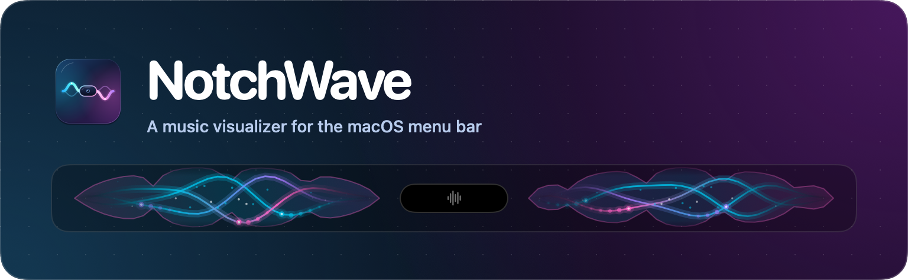
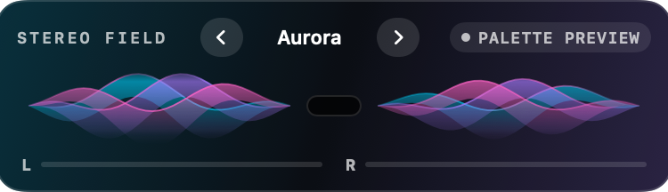
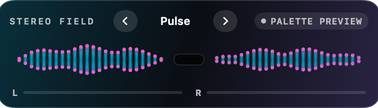
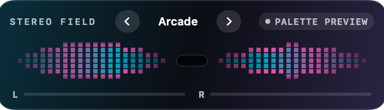
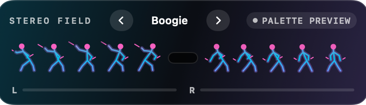

# NotchWave

**[Download NotchWave for macOS](https://github.com/kboss007/NotchWave/releases/latest/download/NotchWave-macOS-Apple-Silicon.dmg)** · [ZIP download](https://github.com/kboss007/NotchWave/releases/latest/download/NotchWave-macOS-Apple-Silicon.zip) · [Release notes](https://github.com/kboss007/NotchWave/releases/latest)

NotchWave is a SwiftUI menu-bar visualizer for macOS 14.2 and later. The included app build targets Apple Silicon. Two transparent trails bring the feel of the Apple Music visualizer to the sides of the notch. Use the preview arrows to cycle through Supernova, Aurora, Pulse, Helix, Cinders, Arcade, Jelly, and Boogie. Boogie keeps dancers visible while listening, even during silence. Disco points, floss swings, and running-man steps respond to the sound’s frequency balance, texture, and beat. Each side uses only its matching stereo channel for loudness, bass, sparks, and the waveform envelope drawn from captured samples. On a display without a notch, the trails use the center of the bar as their anchor.

The controls use native Liquid Glass when built with the macOS 26 SDK or newer and run on macOS 26 or later. The palettes, spectrum, and stereo preview are also available with standard controls on older supported releases.

## Visualizer gallery

| Aurora | Pulse |
| :---: | :---: |
|  |  |
| **Arcade** | **Boogie** |
|  |  |

## Download

The prebuilt app requires an Apple Silicon Mac running macOS 14.2 or later.

1. Open the disk image and drag **NotchWave.app** onto **Applications**. If you downloaded the ZIP, unzip it and move the app to **Applications**.
2. Open NotchWave and look for the island-and-trails icon in the menu bar.
3. Choose **Listen** and allow System Audio Recording when macOS asks.

This release is ad hoc signed. If macOS blocks the first launch, open **System Settings → Privacy & Security** and choose **Open Anyway** if available. [Apple’s guide to opening downloaded apps](https://support.apple.com/en-us/102445).

NotchWave enables **Open at login** the first time you run it from Applications. Use the switch at the bottom of the menu-bar panel to change this. If macOS asks for approval, choose **Approve in Login Items…** in the panel.

While an app is in full screen, open NotchWave’s menu-bar panel and turn on **Fill top bar in full screen** under **Waveform size**. Leave it off to use your usual notch-side layout in full screen. The control appears only in full screen.

## License

Copyright © 2026 kboss007. You may install and run the official app under the [NotchWave Software License](LICENSE). Rights to the source code and artwork are reserved.
